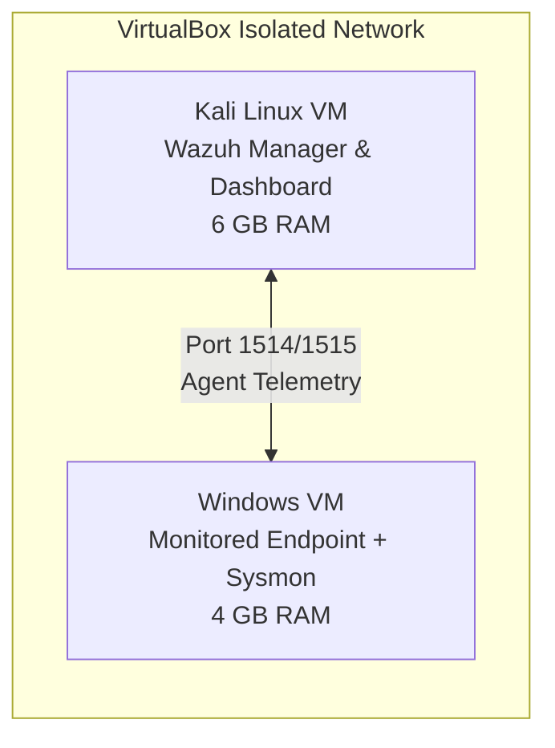
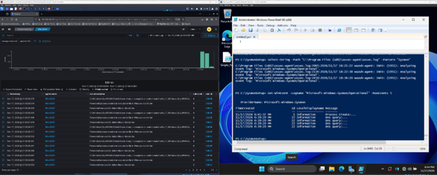

# SOC & Threat Detection Homelab (Wazuh SIEM)

A virtualized Security Operations Center (SOC) and endpoint detection homelab built in **VirtualBox**. This project documents the deployment of a **Wazuh SIEM/XDR** environment, granular Windows telemetry collection via **Sysmon**, alert noise tuning, and simulated threat detection scenarios.

---

## 🎯 Lab Objectives
* Deploy and configure an all-in-one **Wazuh Manager, Indexer, and Dashboard** on Linux.
* Isolate virtual machines on a dedicated hypervisor network to safely conduct security testing.
* Onboard a **Windows endpoint** with **Sysmon** to capture deep process, network, and registry telemetry.
* Reduce false positives through custom rule tuning (`local_rules.xml`) and baseline Security Configuration Assessments (SCA).
* Simulate real-world attack techniques and document end-to-end alert triage and investigation workflows.

---

## 🏗️ Lab Architecture & Virtual Machines

All virtual machines run inside **Oracle VirtualBox** on an isolated **Host-Only / Internal Network** (`<SUBNET_CIDR>`, e.g., `192.168.56.0/24`) with clean baseline snapshots saved prior to testing.

| VM Role | Operating System | Allocated RAM | Network Adapter | Key Services & Tools |
| :--- | :--- | :--- | :--- | :--- |
| **SIEM Server / Red Team** | Kali Linux | 6 GB | Host-Only / Internal | Wazuh Manager, Wazuh Indexer, Wazuh Dashboard, Python HTTP Server (Agent Hosting) |
| **Monitored Endpoint** | Windows | 4 GB | Host-Only / Internal | Wazuh Agent, Microsoft Sysmon |

---

## 📂 Repository Structure

* **[`setup-guides/`](./setup-guides/)** — Step-by-step installation and configuration guides:
 * **[Guide 01: Lab Architecture & Virtual Network Setup](01-lab-architecture.md)** – Isolated Host-Only network (`192.168.56.0/24`), Windows Server 2025 Domain Controller (`Win-DC01`), Wazuh SIEM, and Kali Linux setup.
* **[Guide 02: Active Directory & Baseline CIS Assessment](02-ad-baseline.md)** – Domain configuration (`Company.local`), organizational units, and initial CIS Benchmark scan (**25% baseline score**).
* **[Guide 03: Sysmon Deployment & File Integrity Monitoring (FIM)](03-sysmon-fim.md)** – Enhanced Windows endpoint telemetry via Sysmon, Wazuh `syscheck` configuration for real-time file/registry monitoring, and baseline alert tuning.
* **[Guide 04: Offensive Testing & Detection Validation](04-offensive-testing.md)** – Multi-stage adversary simulations from Kali Linux (`nmap`, `netexec`, `smbclient`, `msfvenom`, encoded PowerShell, registry persistence) mapped to MITRE
* **[Guide 05: hardening-remediation.md]
* ATT&CK and verified in Wazuh.

---

## ✅ Completed Milestones & Key Takeaways
* **Environment Isolation & Snapshots:** Configured VirtualBox isolated networking and established clean recovery snapshots before deploying security tooling.
* **Offline Agent Deployment:** Hosted the Wazuh Windows Agent MSI locally from Kali Linux to enroll the Windows VM without exposing the lab environment to external traffic.
* **Telemetry & Noise Tuning:** Integrated Sysmon event channels into the Wazuh agent configuration (`ossec.conf`) and tuned high-severity baseline alert noise using custom rules.
* **Compliance & Integrity:** Evaluated baseline system hardening with Wazuh Security Configuration Assessment (SCA) and verified File Integrity Monitoring (FIM) alerts.

---

## 📸 Dashboard Preview

