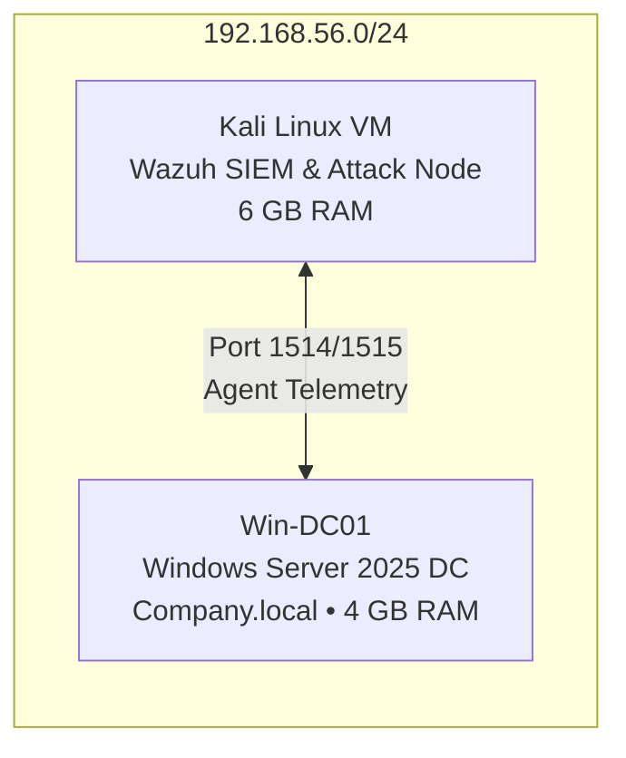

# SOC & Threat Detection Homelab (Wazuh SIEM)

A virtualized Security Operations Center (SOC) and endpoint detection homelab built in **Oracle VirtualBox**. This project documents the deployment of a **Wazuh SIEM/XDR** environment monitoring an Active Directory Domain Controller (`Company.local`), granular Windows telemetry collection via **Sysmon**, MITRE ATT&CK adversary simulations, alert noise tuning, and CIS Benchmark hardening.

---

## 🎯 Lab Objectives
* Deploy and configure an all-in-one **Wazuh Manager, Indexer, and Dashboard** on Linux.
* Isolate virtual machines on a dedicated hypervisor network (`192.168.56.0/24`) to safely conduct security testing.
* Build an Active Directory Domain Controller (**`Win-DC01`** / **`Company.local`**) instrumented with **Sysmon** and **File Integrity Monitoring (FIM)** for deep process, network, file, and registry telemetry.
* Simulate multi-stage attack techniques from **Kali Linux** mapped to **MITRE ATT&CK** and validate end-to-end alert triage.
* Reduce false positives through custom rule tuning (`local_rules.xml`) and harden the domain using Group Policy Objects (GPOs) measured against **CIS Benchmarks**.

---

## 🏗️ Lab Architecture & Virtual Machines

All virtual machines run inside **Oracle VirtualBox** on an isolated **Host-Only Network** (`192.168.56.0/24`) with clean baseline snapshots saved prior to testing.

| VM Role | Hostname / OS | Allocated RAM | Network Adapter | Key Services & Tools |
| :--- | :--- | :--- | :--- | :--- |
| **SIEM Server & Red Team Node** | Kali Linux | 6 GB | Host-Only (`192.168.56.0/24`) | Wazuh Manager, Indexer & Dashboard, `nmap`, `netexec`, `smbclient`, `msfvenom` |
| **Domain Controller / Monitored Endpoint** | `Win-DC01` (Windows Server 2025) | 4 GB | Host-Only (`192.168.56.0/24`) | Active Directory (`Company.local`), DNS, Wazuh Agent, Microsoft Sysmon |

*(Note: Update the table above if your Wazuh Server runs on a separate Ubuntu/Linux VM from Kali.)*

---

## 📂 Repository Structure

* **[`setup-guides/`](./setup-guides/)** — Step-by-step installation and configuration guides:
  * **[Guide 01: Lab Architecture & Virtual Network Setup](./setup-guides/Guide%2001%3A%20Lab%20Architecture%20%26%20Virtual%20Network%20Setup.md)** – Isolated Host-Only network (`192.168.56.0/24`), Windows Server 2025 Domain Controller (`Win-DC01`), Wazuh SIEM, and Kali Linux setup.
  * **[Guide 02: Active Directory & Baseline CIS Assessment](./setup-guides/Guide%2002%3A%20Active%20Directory%20%26%20Baseline%20CIS%20Assessment.md)** – Domain configuration (`Company.local`), organizational units, and initial CIS Benchmark scan (**25% baseline score**).
  * **[Guide 03: Sysmon Deployment & File Integrity Monitoring (FIM)](./setup-guides/Guide%2003%3A%20Sysmon%20Deployment%20%26%20File%20Integrity%20Monitoring%20(FIM).md)** – Enhanced Windows endpoint telemetry via Sysmon, Wazuh `syscheck` configuration for real-time file/registry monitoring, and baseline alert tuning.
  * **[Guide 04: Offensive Testing & Detection Validation](./setup-guides/Guide%2004%3A%20Offensive%20Testing%20%26%20Detection%20Validation.md)** – Multi-stage adversary simulations from Kali Linux (`nmap`, `netexec`, `smbclient`, `msfvenom`, encoded PowerShell, registry persistence) mapped to MITRE ATT&CK and verified in Wazuh.
  * **[Guide 05: Security Hardening, Alert Tuning & CIS Benchmark Re-Scan](./setup-guides/Guide%2005%3A%20Security%20Hardening%2C%20Alert%20Tuning%20%26%20CIS%20Benchmark%20Re-Scan.md)** – Post-simulation artifact cleanup, granular Wazuh `local_rules.xml` tuning (Rule 61618), Active Directory GPO hardening, and CIS Benchmark compliance verification.

---

## ✅ Completed Milestones & Key Takeaways
* **Environment Isolation & Snapshots:** Configured VirtualBox isolated networking (`192.168.56.0/24`) and established clean recovery snapshots prior to offensive testing.
* **Active Directory & Telemetry Engineering:** Promoted `Win-DC01` to a Windows Server 2025 Domain Controller (`Company.local`) and integrated Microsoft Sysmon and Wazuh FIM (`syscheck`) for real-time process, network, and registry monitoring.
* **Adversary Simulation & Detection Validation:** Executed reconnaissance, SMB enumeration, payload generation, encoded PowerShell, and registry persistence from Kali Linux, mapping detections to MITRE ATT&CK in Wazuh.
* **Alert Tuning & CIS Hardening:** Eliminated false-positive alert fatigue (Rule 61618 `svchost.exe`) via `local_rules.xml` and remediated domain vulnerabilities via GPOs, improving compliance from the **25% CIS baseline**.
