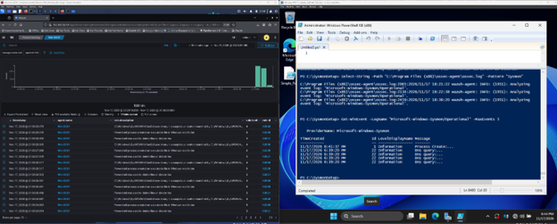

# Guide 02: Windows Endpoint Telemetry with Sysmon & Wazuh

This guide documents deploying **Microsoft Sysmon** on an isolated Windows virtual machine (`Win-DC01`), forwarding the `Microsoft-Windows-Sysmon/Operational` event channel to the **Wazuh Manager** on Kali Linux, and elevating Sysmon telemetry into actionable SIEM alerts via custom detection rules.

---

## 🎯 Objectives
* Transfer Sysmon binaries and the **SwiftOnSecurity** configuration schema to an isolated Windows endpoint without direct external internet exposure.
* Configure the Windows Wazuh Agent (`ossec.conf`) to ingest Sysmon EventChannel logs.
* Write a custom Wazuh rule (`local_rules.xml`) to elevate baseline Level 0 Sysmon process creation events into visible dashboard alerts.
* Document troubleshooting steps for architecture mismatches and post-snapshot agent key conflicts.

---

## 🛠️ Step 1: Stage Sysmon & Configuration Files on Kali

Because the Windows VM resides on an isolated VirtualBox Host-Only network (`192.168.56.0/24`), installation files are staged on the Kali Linux server and served locally over HTTP.

1. Download the official Sysinternals binary (`Sysmon.exe` for 32-bit/x86 systems or `Sysmon64.exe` for 64-bit systems) and the community baseline XML ruleset from [SwiftOnSecurity/sysmon-config](https://github.com):
   ```bash
   mkdir ~/sysmon && cd ~/sysmon
   curl -L -A "Mozilla/5.0" -o Sysmon.exe https://sysinternals.com
   curl -L -o sysmonconfig-export.xml https://githubusercontent.com
   ```
2. Start a temporary Python HTTP server on port `8000` over the isolated network interface:
   ```bash
   python3 -m http.server 8000
   ```

---

## 💻 Step 2: Install Sysmon on the Windows Endpoint

Open **PowerShell as Administrator** on `Win-DC01`, pull the staged files from the Kali host (`<WAZUH_MANAGER_IP>`), and install Sysmon with the custom configuration:

```powershell
mkdir C:\SysmonSetup -Force
Invoke-WebRequest -Uri "http://<WAZUH_MANAGER_IP>:8000/Sysmon.exe" -OutFile "C:\SysmonSetup\Sysmon.exe"
Invoke-WebRequest -Uri "http://<WAZUH_MANAGER_IP>:8000/sysmonconfig-export.xml" -OutFile "C:\SysmonSetup\sysmonconfig.xml"

cd C:\SysmonSetup
.\Sysmon.exe -accepteula -i sysmonconfig.xml
```

Verify that the Sysmon service initialized cleanly:
```powershell
Get-Service Sysmon
```

---

## 🔗 Step 3: Forward Sysmon Logs to the Wazuh Agent

1. Open the Windows Wazuh Agent configuration file (`C:\Program Files (x86)\ossec-agent\ossec.conf` or `C:\Program Files\ossec-agent\ossec.conf`):
   ```powershell
   notepad "C:\Program Files (x86)\ossec-agent\ossec.conf"
   ```
2. Inside the `<ossec_config>` block—directly below the standard `Application`, `Security`, and `System` `<localfile>` entries—add the Sysmon event channel:
   ```xml
   <localfile>
     <location>Microsoft-Windows-Sysmon/Operational</location>
     <log_format>eventchannel</log_format>
   </localfile>
   ```
3. Save the file and restart the Wazuh Agent service:
   ```powershell
   Restart-Service WazuhSvc
   ```
4. Confirm in `ossec.log` that the agent successfully hooked into the Sysmon channel:
   ```powershell
   Select-String -Path "C:\Program Files (x86)\ossec-agent\ossec.log" -Pattern "Sysmon"
   # Expected output: INFO: (1951): Analyzing event log: 'Microsoft-Windows-Sysmon/Operational'.
   ```

---

## 🚨 Step 4: Elevate Sysmon Alerts on the Wazuh Manager

By default, Wazuh evaluates routine Sysmon telemetry at **Level 0** (below the default Level 3 dashboard alert threshold). To surface Sysmon Process Creation events (`sysmon_event1`) for threat hunting and rule tuning, add a custom rule on the Kali Wazuh Manager:

1. Open `/var/ossec/etc/rules/local_rules.xml`:
   ```bash
   sudo nano /var/ossec/etc/rules/local_rules.xml
   ```
2. Add Rule `100100` inside the `<group>` block:
   ```xml
   <rule id="100100" level="5">
     <if_group>sysmon_event1</if_group>
     <description>Sysmon - Process Creation: \$(win.eventdata.image)</description>
     <group>sysmon,sysmon_process_creation,</group>
   </rule>
   ```
3. Restart `wazuh-manager` to apply the rule:
   ```bash
   sudo systemctl restart wazuh-manager
   ```

---

## 🔧 Troubleshooting & Lessons Learned

* **Architecture Mismatch (`Sysmon64.exe` vs. `Sysmon.exe`):** Attempting to run `Sysmon64.exe` on a 32-bit (`x86`) Windows guest returns *"The specified executable is not a valid application for this OS platform."* Checking `[Environment]::Is64BitOperatingSystem` confirmed the x86 architecture, resolved by deploying the 32-bit `Sysmon.exe` binary.
* **Post-Snapshot Agent Key Desynchronization (`Duplicate agent name`):** Rolling back a VM snapshot created prior to agent registration leaves the endpoint without a valid `client.keys` entry, causing the manager to reject enrollment with `ERROR: Duplicate agent name: Win-DC01`. Resolved by removing the stale agent ID on the manager (`sudo /var/ossec/bin/manage_agents -r <ID>`), restarting `wazuh-manager`, and restarting `WazuhSvc` on Windows to trigger clean auto-enrollment.
* **Dashboard Alert Thresholds:** Even when `ossec.log` confirms `Analyzing event log: 'Microsoft-Windows-Sysmon/Operational'`, events will not appear in the Threat Hunting dashboard until elevated to Level 3+ via `local_rules.xml` or triggered by higher-severity rules (such as encoded PowerShell execution).

---

## 📸 Verification Screenshots




